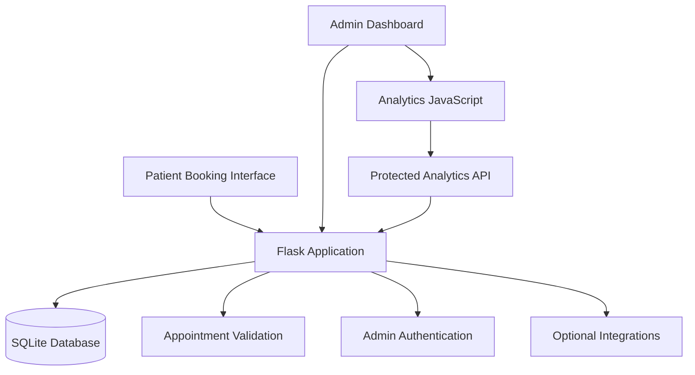

# ClinicFlow Advanced

## Live Demo

[Open ClinicFlow Advanced](https://clinicflow-advanced-demo.onrender.com)

ClinicFlow Advanced is an educational portfolio demonstration.
Use fictional patient information only.

Public demo safety settings:
- WhatsApp outbound messaging is disabled.
- Reminder sending and scheduling are disabled.
- External Google Calendar integration is disabled.
- Real patient information must not be entered.

**Demo credentials for booking:**
- Patient: `Demo Patient`
- Phone: `+12025550123`

**Hosting note:** Render Free may take time to start after inactivity.
SQLite appointment records may reset when the service restarts or redeploys.

A Flask-based clinic appointment management application featuring
patient booking, an administrative dashboard, an AI receptionist
interface, appointment reminders, and integration-ready workflows.

## Project Overview

ClinicFlow Advanced helps demonstrate how a clinic can organize
appointments through a web application while maintaining an
administrative view of booking activity.

The project includes a patient-facing interface and a protected
admin dashboard.

## Features

- Patient appointment booking
- Doctor and time-slot selection
- Appointment validation
- Duplicate booking prevention
- Admin login and protected endpoints
- Appointment search and filtering
- Appointment cancellation
- Secure administrative analytics dashboard
- Daily appointment trends and doctor-wise booking charts
- Cancellation rate and busiest appointment time analysis
- CSV export interface
- AI receptionist chatbot interface
- Built-in clinic information responses
- WhatsApp delivery monitoring interface
- Reminder preview functionality
- Google Calendar integration code
- SQLite appointment storage
- CSRF protection for administrative actions

## Technology Stack

- Python
- Flask
- SQLite
- HTML
- CSS
- JavaScript
- Waitress
- APScheduler

Optional integrations include OpenAI, WhatsApp Cloud API,
and Google Calendar.

## Installation

### 1. Clone or download the project

Open a terminal inside the project directory.

### 2. Create a virtual environment

Windows:

```powershell
python -m venv .venv
.\.venv\Scripts\Activate.ps1
```

### 3. Install dependencies

```powershell
python -m pip install -r requirements.txt
```

### 4. Configure environment settings

Create a local `.env` file with suitable development settings.

Recommended safety defaults:

```dotenv
LIVE_MODE=false
ENABLE_SCHEDULER=false
REMINDER_SEND_ENABLED=false
WHATSAPP_OUTBOUND_ENABLED=false
WHATSAPP_STATUS_STORAGE_ENABLED=false
```

Configure a strong local admin password and Flask secret key.

Never commit real credentials or patient data to GitHub.

### 5. Start the application

```powershell
python run_local.py
```

Open:

http://127.0.0.1:5000

Admin dashboard:

http://127.0.0.1:5000/admin

The included launcher is intended for local use.

## System Architecture

The application uses Flask to connect the patient booking interface,
protected administrative dashboard, and SQLite appointment storage.



## Advanced Analytics

ClinicFlow Advanced includes an administrator-only analytics dashboard
for exploring appointment activity.

The analytics dashboard provides:

- **Cancellation Rate:** Percentage of appointments marked cancelled.
- **Total Doctors:** Number of doctors represented in the appointment data.
- **Daily Appointment Trends:** Booking counts grouped by appointment date.
- **Doctor-wise Appointments:** Appointment counts grouped by doctor.
- **Busiest Appointment Times:** Appointment counts grouped by time slot.

The frontend uses JavaScript to display responsive horizontal bar charts.
Analytics data is provided by the protected `/api/admin/analytics` endpoint.

The analytics response contains aggregated statistics rather than
patient names or phone numbers.

This feature demonstrates backend data aggregation, REST API development,
administrative access control, and data visualization.

## Main Application Modules

- `app.py` - Flask routes, application logic and analytics API
- `static/analytics.js` - Administrative analytics visualization
- `wsgi.py` - WSGI application entry point
- `run_local.py` - Local Waitress server launcher
- `templates/` - Patient and admin interfaces
- `requirements.txt` - Python dependencies

## Appointment Workflow

1. A patient opens the booking interface.
2. The patient enters booking information.
3. The application validates the input.
4. SQLite stores the appointment.
5. The admin dashboard displays appointment information.
6. Authorized administrators can cancel appointments.

## AI Receptionist

The chatbot supports built-in responses about clinic hours,
available doctors, booking and cancellation guidance.

An optional OpenAI integration is present in the application,
but live API operation has not been verified by the isolated tests.

## Reminder and Messaging Safety

Reminder functionality currently operates in preview-only mode.

The project includes a separate outbound WhatsApp safety guard.

Recommended local settings:

```dotenv
REMINDER_SEND_ENABLED=false
WHATSAPP_OUTBOUND_ENABLED=false
WHATSAPP_STATUS_STORAGE_ENABLED=false
```

Do not enable live messaging without appropriate configuration,
consent, authorization and testing.

## Testing

The following workflows passed isolated or local tests:

- Homepage rendering
- Admin dashboard rendering
- Admin authentication protection
- CSRF validation for cancellation
- Appointment creation
- Duplicate booking rejection
- Invalid phone number rejection
- Appointment cancellation
- Built-in chatbot responses
- WhatsApp outbound blocking
- SQLite database integrity
- Reminder preview safety

External calendar and AI service calls were not exercised
in the isolated functional tests.

### Automated Tests (pytest)

ClinicFlow Advanced includes six automated tests across three Python test files.

Install pytest in your activated virtual environment:

    python -m pip install pytest

Run all automated tests:

    python -m pytest tests/ -v

The automated tests cover:

- Flask homepage rendering.
- Four invalid appointment request scenarios.
- Successful appointment creation (HTTP 201).
- Duplicate appointment rejection (HTTP 409).
- Verification that duplicate bookings create only one database record.

Tests run in separate Python processes using temporary SQLite databases.
Live mode, background scheduling, reminder sending, and outbound WhatsApp
messaging are disabled in the test environment.

Google Calendar synchronization is mocked in the successful booking test.
Live external integrations are not verified by this test suite.

Latest verified local result: 6 tests passed (November 2026).

Additional workflows listed above were checked separately during earlier
local development. The automated suite does not yet cover every feature.

## Known Limitations

- Reminder sending is not implemented for live operation.
- Google Calendar integration has not been verified end-to-end.
- OpenAI integration has not been verified end-to-end.
- WhatsApp outbound messaging is disabled by default.
- This application is not validated for production clinical use.
- The demonstration does not provide medical advice.

## Security Notes

- Keep `.env` private.
- Do not publish real SQLite patient databases.
- Do not publish credential files or API tokens.
- Use HTTPS and appropriate deployment security controls
  before considering any public deployment.
- Review privacy, authentication, logging and access controls
  before handling real patient information.

## Portfolio Description

ClinicFlow Advanced is a Python Flask clinic appointment management
project featuring SQLite-based booking, a protected administrative
dashboard, appointment cancellation, an AI receptionist interface,
reminder previews, secure appointment analytics, interactive data visualizations and optional external service integrations.

## Project Status

Core local demonstration workflows have passed their tested scenarios.
Live external integrations require additional verification.

## Project Screenshots

### Appointment Booking and AI Receptionist

The homepage provides an appointment booking form and an
AI receptionist interface for scheduling assistance.


### Admin Dashboard

The administrative dashboard displays appointment statistics,
booking management tools, and reminder previews.


**Demo safety:** Outbound WhatsApp messaging is disabled,
and appointment reminders operate in preview-only mode.
The screenshots are for portfolio demonstration purposes.

### Advanced Analytics Dashboard

The protected analytics dashboard visualizes daily appointment trends,
doctor-wise booking activity, cancellation statistics and popular time slots.


## Public Demo Deployment (Render)

ClinicFlow Advanced can be deployed as a public portfolio demonstration
using Render and Gunicorn.

### Demo Safety

- `PUBLIC_DEMO_MODE=true` enables public-demo restrictions.
- Only the fictional patient name `Demo Patient` and phone number
  `+12025550123` are accepted for demo bookings.
- The public demo allows a maximum of 30 active appointments.
- Live Google Calendar integration is disabled.
- WhatsApp webhooks and outbound messaging are disabled.
- Automated reminder sending and background scheduling are disabled.
- The public chatbot uses predefined responses instead of external AI.
- Do not enter real patient details or medical information.

### Temporary Demo Storage

The demo uses a SQLite database stored on Render's ephemeral filesystem.

**Demo appointments are not permanent.** The database may be reset
when the service restarts, is redeployed, or is replaced.

This deployment is intended for portfolio demonstrations, not
production clinic operations or real patient records.

### Administrator Configuration

The Render service requires an `ADMIN_PASSWORD` environment variable
configured privately in the Render dashboard.

The Flask `SECRET_KEY` is generated through the Render configuration.

Never commit passwords, `.env` files, database files, API tokens,
or other private credentials to GitHub.

### Deployment Configuration

The repository includes `render.yaml` with the Gunicorn startup
command and public-demo safety settings.

The demo database path is `clinicflow_render_demo.db`.
