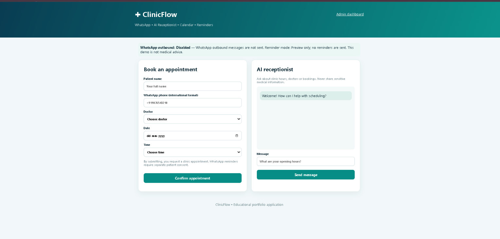
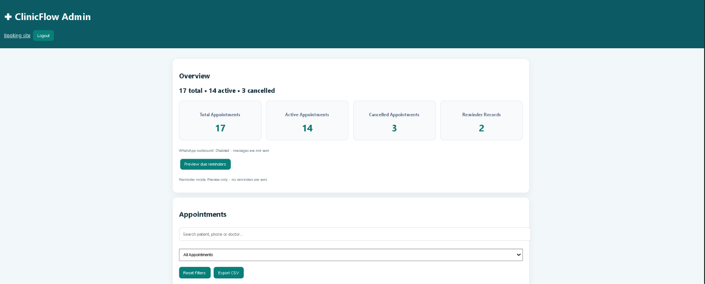
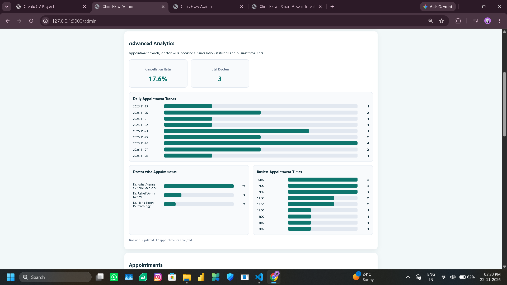
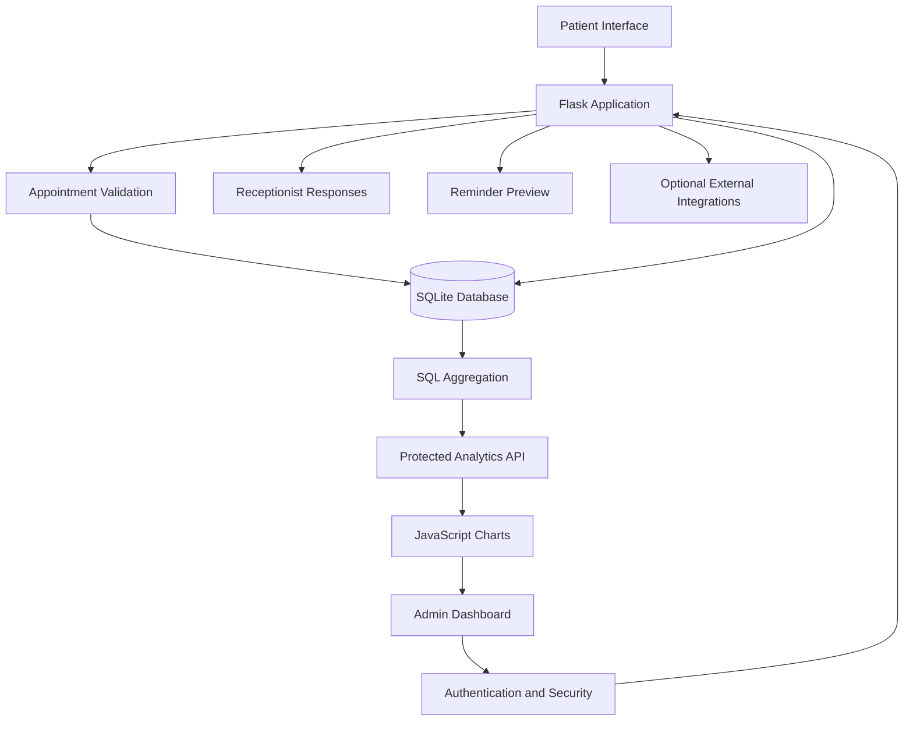
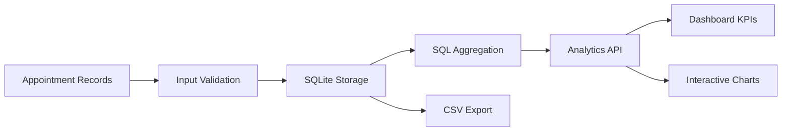

# ClinicFlow Advanced

### Smart Appointment Management & Healthcare Data Analytics

[](https://github.com/gangwarharshit037-tech/ClinicFlow-Advanced/actions/workflows/tests.yml)


## Live Demo

**[Launch ClinicFlow Advanced](https://clinicflow-advanced-demo.onrender.com/)**

ClinicFlow Advanced is a full-stack Python web application
that demonstrates clinic appointment management, administrative
analytics, secure authentication, interactive data visualization,
and integration-ready healthcare automation.

The application is designed as an educational portfolio project,
combining software development, database management, data analytics,
API development, security engineering, and cloud deployment.

> This application is an educational demonstration, not a
> production healthcare system. Never enter real patient information.

## Quick Demo Guide

1. Open the live application.
2. Click **Use Demo Details**.
3. Select a doctor, future date, and available time.
4. Click **Confirm appointment**.
5. Explore the AI receptionist using clinic-related questions.

The public demo accepts only these sample booking details:

| Field | Demo value |
|---|---|
| Patient name | Demo Patient |
| Phone number | +12025550123 |

No administrator credentials are publicly shared.

The Render Free instance may take 50 seconds or more to start
after inactivity.

## Project Objectives

- Build a functional appointment management application.
- Transform appointment records into meaningful analytics.
- Demonstrate database querying and data aggregation.
- Develop secure administrative REST endpoints.
- Implement responsive frontend interfaces.
- Apply automated testing and regression testing.
- Deploy a working application to a cloud platform.

## Key Features

### Appointment Management

- Patient-facing appointment booking interface.
- Doctor, date, and time-slot selection.
- Automatic demo patient details filling.
- Server-side appointment validation.
- Duplicate active appointment prevention.
- Appointment search and filtering.
- Administrative appointment cancellation.
- CSV export for further analysis.
- Responsive desktop and mobile interfaces.

### Advanced Analytics

- Total appointment count.
- Active and cancelled appointment counts.
- Appointment cancellation rate.
- Number of doctors represented in appointment records.
- Daily appointment trends.
- Doctor-wise appointment distribution.
- Busiest appointment time slots.
- Responsive horizontal bar charts.
- Automatic analytics refresh after appointment cancellation.
- Protected analytics API returning aggregated statistics.

### AI Receptionist

- Clinic opening hours.
- Available doctors.
- Appointment booking guidance.
- Appointment cancellation guidance.
- Restricted public-demo responses.
- Optional OpenAI integration outside public demo mode.

The public demo uses predefined responses rather than external
AI service calls.

### Administrative Dashboard

- Password-protected administrator access.
- Appointment management and filtering.
- Interactive analytics dashboard.
- CSV data export.
- Reminder preview functionality.
- WhatsApp delivery monitoring interface.
- Secure logout.

## Project Screenshots

### Appointment Booking and AI Receptionist



### Administrative Dashboard



### Advanced Analytics Dashboard



Screenshots demonstrate portfolio functionality and may show
earlier interface versions.

## Technology Stack

| Category | Technologies |
|---|---|
| Programming | Python 3.12 |
| Backend | Flask |
| Frontend | HTML, CSS, JavaScript |
| Database | SQLite |
| Data Analytics | SQL aggregation, Python, JavaScript |
| Data Visualization | Responsive JavaScript bar charts |
| API Architecture | REST-style JSON endpoints |
| Local Server | Waitress |
| Cloud Server | Gunicorn |
| Scheduling | APScheduler |
| Automated Testing | pytest |
| Version Control | Git and GitHub |
| Continuous Integration | GitHub Actions |
| Cloud Deployment | Render |
| Optional Integrations | OpenAI, Google Calendar, WhatsApp Cloud API |

## System Architecture



The application separates patient-facing workflows from
protected administrative operations.

Flask handles request processing, validation, authentication,
database operations, and JSON responses. JavaScript handles
frontend interactions and analytics visualization.

## Data Analytics Workflow



The analytics workflow demonstrates how transactional appointment
records can be converted into operational insights.

### Key Performance Indicators

| KPI | Description |
|---|---|
| Total Appointments | Number of recorded appointments |
| Active Appointments | Appointments with Booked status |
| Cancelled Appointments | Appointments with Cancelled status |
| Cancellation Rate | Cancelled appointments divided by total appointments, multiplied by 100 |
| Total Doctors | Distinct doctors represented in appointment data |
| Daily Trends | Appointment counts grouped by appointment date |
| Doctor Distribution | Appointment counts grouped by doctor |
| Busiest Time Slots | Appointment counts grouped by scheduled time |

### Analytics Applications

The dashboard demonstrates how appointment data can support:

- Understanding appointment demand.
- Comparing booking activity across doctors.
- Identifying frequently selected appointment times.
- Monitoring cancellation patterns.
- Exporting records for additional analysis.

These insights are based on demonstration data and should not
be interpreted as real healthcare operational findings.

The protected analytics API returns aggregated statistics
rather than patient names or phone numbers.

## Database Overview

SQLite provides lightweight relational database storage.

The appointment records contain information such as:

- Appointment identifier.
- Patient name.
- Phone number.
- Doctor.
- Appointment date.
- Appointment time.
- Appointment status.

The application also includes delivery and webhook-related
storage structures.

Database-level duplicate active-slot protection helps prevent
multiple active bookings for the same doctor, date, and time.

The public demo uses fictional booking details only.

## API Endpoints

### Public Endpoints

| Method | Endpoint | Purpose |
|---|---|---|
| GET | `/` | Public booking interface |
| POST | `/api/book` | Create an appointment |
| POST | `/api/chat` | Receptionist response |
| GET | `/admin/login` | Administrator login page |
| POST | `/admin/login` | Administrator authentication |

### Protected Administrative Endpoints

| Method | Endpoint | Purpose |
|---|---|---|
| GET | `/admin` | Administrative dashboard |
| POST | `/admin/logout` | Secure logout |
| GET | `/api/admin/appointments` | Retrieve appointment records |
| GET | `/api/admin/analytics` | Retrieve aggregated analytics |
| POST | `/api/admin/appointments/<aid>/cancel` | Cancel an appointment |
| POST | `/api/admin/reminders/run` | Run reminder preview workflow |
| GET | `/api/admin/deliveries` | Retrieve delivery records |

### Integration Endpoints

| Method | Endpoint | Purpose |
|---|---|---|
| GET | `/webhook/whatsapp` | Webhook verification |
| POST | `/webhook/whatsapp` | Webhook event handling |

WhatsApp webhook endpoints are disabled in public demo mode.

Administrative operations require appropriate authentication,
with CSRF protection applied to relevant state-changing actions.

## Security and Privacy

ClinicFlow Advanced includes multiple application security controls:

| Security control | Implementation |
|---|---|
| Authentication | Protected administrator access |
| Login rate limiting | Failed login attempt restrictions |
| Rate limiter concurrency | Concurrent request handling |
| CSRF protection | Protected cancellation and logout actions |
| Session cookies | HttpOnly, SameSite and configurable Secure settings |
| Content Security Policy | Restricted script and resource loading |
| Clickjacking protection | Frame restrictions |
| MIME protection | X-Content-Type-Options |
| Permissions Policy | Camera, microphone and geolocation restrictions |
| Proxy handling | Proxy IP security checks |
| Input validation | Server-side booking validation |
| Duplicate prevention | Database-backed active-slot protection |
| Credential management | Environment-based configuration |

The public deployment uses HTTPS.

These controls demonstrate security-conscious development.
They do not constitute a professional security audit,
regulatory compliance certification, or production readiness.

## Public Demo Safety

The deployed application uses:

```dotenv
PUBLIC_DEMO_MODE=true
LIVE_MODE=false
ENABLE_SCHEDULER=false
REMINDER_SEND_ENABLED=false
WHATSAPP_OUTBOUND_ENABLED=false
WHATSAPP_STATUS_STORAGE_ENABLED=false
```

Additional public demo restrictions:

- Only the designated fictional patient details are accepted.
- A maximum of 30 active appointments is permitted.
- Appointment dates must fall within the allowed future booking window.
- External Google Calendar calls are disabled.
- WhatsApp webhooks are disabled.
- Outbound WhatsApp messaging is disabled.
- Automatic reminder sending is disabled.
- The receptionist uses predefined responses.

Never enter real personal information or medical records.

## Project Structure

```text
ClinicFlow-Advanced/
|
|-- app.py
|-- wsgi.py
|-- run_local.py
|-- login_rate_limiter.py
|-- reminder_integration.py
|-- reminder_lifecycle.py
|-- whatsapp_*.py
|-- requirements.txt
|-- render.yaml
|-- .env.example
|-- .gitignore
|-- README.md
|
|-- templates/
|   |-- index.html
|   |-- admin.html
|   `-- login.html
|
|-- static/
|   |-- booking.css
|   |-- booking.js
|   |-- admin.css
|   |-- admin.js
|   |-- analytics.js
|   |-- login.css
|   |-- login.js
|   |-- whatsapp_monitoring.js
|   `-- favicon.svg
|
|-- tests/
|   `-- 20 automated test modules
|
|-- docs/
|   `-- screenshots/
|
`-- .github/
    `-- workflows/
        `-- tests.yml
```

## Local Installation

### 1. Prerequisites

- Python 3.12 recommended.
- Git.
- Windows PowerShell or an equivalent terminal.
- A modern web browser.

### 2. Clone the Repository

```powershell
git clone https://github.com/gangwarharshit037-tech/ClinicFlow-Advanced.git
cd ClinicFlow-Advanced
```

### 3. Create a Virtual Environment

```powershell
python -m venv .venv
.\.venv\Scripts\Activate.ps1
```

### 4. Install Dependencies

```powershell
python -m pip install -r requirements.txt
python -m pip install pytest
```

### 5. Configure the Environment

```powershell
Copy-Item .env.example .env
```

Review the local `.env` file and configure the following
safe development settings:

```dotenv
PUBLIC_DEMO_MODE=true
LIVE_MODE=false
ENABLE_SCHEDULER=false
REMINDER_SEND_ENABLED=false
WHATSAPP_OUTBOUND_ENABLED=false
WHATSAPP_STATUS_STORAGE_ENABLED=false
DATABASE_PATH=clinicflow_local_demo.db
```

Configure a strong private `ADMIN_PASSWORD` and a unique
`SECRET_KEY`.

A random Flask secret can be generated using:

```powershell
python -c "import secrets; print(secrets.token_hex(32))"
```

Never commit the resulting credentials to GitHub.

### 6. Run the Application

```powershell
python -m flask --app app run --host 127.0.0.1 --port 5000
```

Open the local application:

- Booking interface: http://127.0.0.1:5000/
- Admin dashboard: http://127.0.0.1:5000/admin

The Flask development server is intended for local testing only.

The repository also includes `run_local.py` as a local
Waitress server launcher.

Secure session cookies are enabled in public demo mode.
For local administrator testing, use HTTPS or an appropriately
configured non-public development environment.

## Automated Testing

ClinicFlow Advanced includes **46 automated tests across
20 Python test modules**.

### Run the Test Suite

```powershell
python -m pytest -q
```

### Latest Verified Local Result

```text
46 passed in 19.30s
```

Verified on November 24, 2026.

### Test Coverage Areas

| Area | Tested scenarios |
|---|---|
| Application | Homepage rendering |
| Booking | Valid and invalid appointment requests |
| Database | Duplicate appointment prevention |
| Administration | Authentication and protected access |
| Cancellation | Appointment cancellation and CSRF validation |
| Analytics | Protected appointment statistics |
| Authentication | Login rate limiting |
| Concurrency | Concurrent login and rate limiter behavior |
| Rate Limiter | Capacity, expiration and in-flight requests |
| Session Security | Cookie configuration |
| HTTP Security | Security headers and proxy IP handling |
| Logout | CSRF-protected administrative logout |
| Chatbot | Restricted public demo responses |
| Demo Interface | Conditional instructions and sample details |

Tests use isolated processes and temporary databases where
appropriate.

External messaging and scheduling are disabled in the isolated
test environment.

Live external integrations are not verified by the automated
test suite.

### Manual Verification

The following workflows were also manually checked:

- Desktop and mobile interfaces.
- Automatic demo details filling.
- Local appointment booking.
- Live Render appointment booking.
- Appointment cancellation.
- Analytics refresh after cancellation.
- CSV export.
- Reminder preview.
- Favicon loading.
- Administrative login and logout.
- Live HTTP security headers.

## Continuous Integration

GitHub Actions provides an automated testing workflow through:

```text
.github/workflows/tests.yml
```

The workflow badge at the top of this README reflects
the GitHub Actions workflow status.

## Cloud Deployment

ClinicFlow Advanced is deployed on Render using Gunicorn.

The repository includes a `render.yaml` configuration file.

| Setting | Configuration |
|---|---|
| Hosting | Render |
| Plan | Free |
| Runtime | Python 3.12.8 |
| Application Server | Gunicorn |
| Workers | 1 |
| Database | SQLite |
| Public Demo Mode | Enabled |
| External Messaging | Disabled |

Production hosting command:

```bash
gunicorn --workers 1 --bind 0.0.0.0:$PORT wsgi:app
```

The administrator password is configured privately in Render.
The Flask secret key is generated through the deployment
configuration.

## Known Limitations

- Render Free may spin down after inactivity.
- Initial requests may take 50 seconds or more.
- SQLite storage on Render is ephemeral.
- Demo appointment records may reset after restarts or redeployments.
- The public demo has a limited active appointment capacity.
- Reminder sending is not implemented for live operation.
- Live OpenAI integration has not been verified end-to-end.
- Live Google Calendar integration has not been verified end-to-end.
- WhatsApp outbound messaging is disabled.
- The application is not validated for production clinical use.

## Future Enhancements

Potential improvements include:

- PostgreSQL-based persistent database storage.
- Advanced date-range analytics filters.
- Additional operational performance indicators.
- Excel and Power BI reporting workflows.
- Role-based administrative access control.
- Browser-based automated end-to-end tests.
- Persistent distributed login rate limiting.
- Additional accessibility testing.
- Verified external service integrations.
- Containerized deployment.

These are proposed enhancements, not currently implemented
features.

## Skills Demonstrated

- Python application development.
- Flask backend development.
- SQL querying and database management.
- Data aggregation and KPI calculation.
- Data visualization and dashboard development.
- REST API development.
- HTML, CSS and JavaScript.
- Authentication and application security.
- Automated testing and debugging.
- Git and GitHub version control.
- Continuous integration.
- Cloud application deployment.
- Technical documentation.

## Portfolio Summary

ClinicFlow Advanced is a full-stack Python and Flask project
that combines appointment management with secure administrative
analytics.

It demonstrates SQL-based data aggregation, KPI dashboards,
interactive visualizations, CSV export, REST API development,
security controls, automated testing, and cloud deployment.

The project is suitable for demonstrating practical skills
relevant to data analytics and software development roles.

## Author

**Harshit Gangwar**

B.Sc. (Hons.) Computer Science

Areas of interest: Data Analytics, Python Development,
SQL, Business Intelligence, and Software Development.

- GitHub: https://github.com/gangwarharshit037-tech
- Repository: https://github.com/gangwarharshit037-tech/ClinicFlow-Advanced
- Live Demo: https://clinicflow-advanced-demo.onrender.com/

## Project Disclaimer

ClinicFlow Advanced is an educational portfolio application.
It does not provide medical advice and is not intended for
real clinical operations or patient record management.

Never publish real patient data, passwords, API tokens,
private database files, or other sensitive information.

---

Built with Python, Flask, SQLite and JavaScript.
